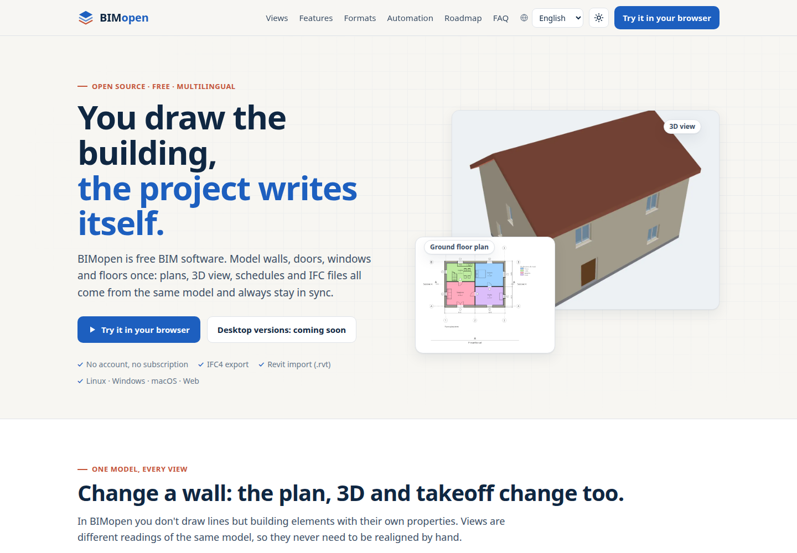

<h1 align="center">BIMopen — website</h1>

  <a href="https://atsanna.github.io/bimopen-site/?lang=en"><b>Open the website</b></a>

  

This repository holds the **built** website of BIMopen, served by GitHub Pages. It contains no
source code: only the pages, their translations and images, as they are published.

**BIMopen** is an open-source BIM modeller written in pure Rust, in the spirit of Autodesk
Revit: you model the building (levels, layered walls, doors and windows, curtain walls, floors,
roofs, stairs, rooms) and plans, sections, 3D views, schedules and sheets are views of the same
model, kept in step. It exports IFC4, prints vector PDFs and reads `.rvt` files. The interface
is available in six languages: Italian, English, German, French, Spanish and Arabic (right to
left).

> **Work in progress.** BIMopen is under active development. Desktop versions (Linux, Windows,
> macOS) and the source code are not public yet: they are coming soon.

## License

BIMopen and this site are licensed under either of [MIT](LICENSE-MIT) or
[Apache-2.0](LICENSE-APACHE), at your option. See [NOTICE](NOTICE) for the dependencies and
their attributions.

Autodesk and Revit are trademarks or registered trademarks of Autodesk, Inc. BIMopen is an
independent project, not affiliated with or endorsed by Autodesk.
